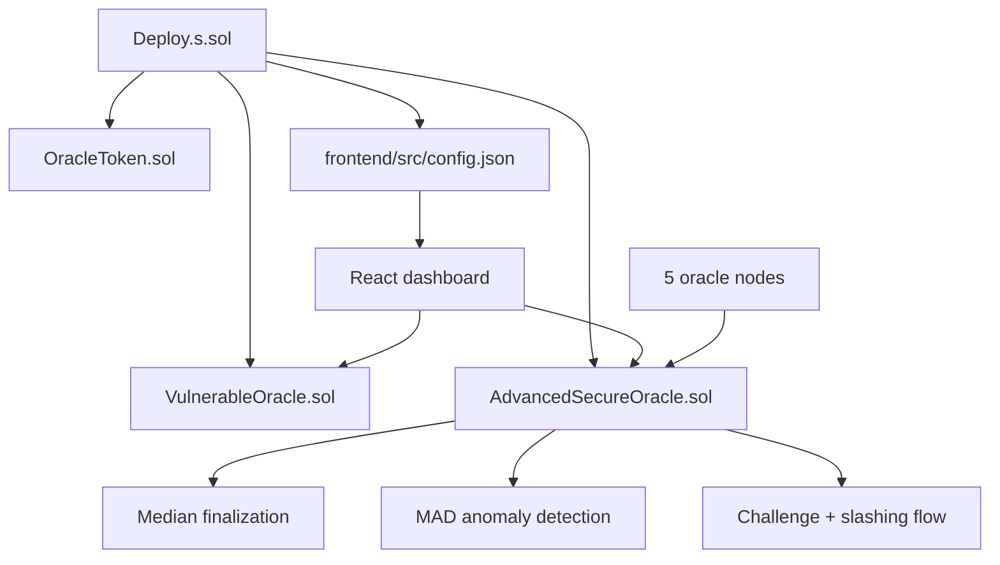

# Architecture

## Overview

This project is a local full-stack simulation of eclipse-attack defenses for oracle systems. It compares two architectures:

1. `VulnerableOracle.sol`
   A single trusted node publishes the price directly.
2. `AdvancedSecureOracle.sol`
   A 5-node oracle committee uses staking, commit-reveal, quorum finalization, anomaly detection, and slashing.

The frontend is a React/Vite dashboard that drives both flows against a local Anvil chain.

## Diagram

## Runtime Layers

### Smart contracts

- `contracts/VulnerableOracle.sol`
  Shows the single-point-of-failure baseline.
- `contracts/SecureOracle.sol`
  Preserves the intermediate quorum-only version for comparison.
- `contracts/OracleToken.sol`
  Minimal ERC-20-style staking token used for collateral and slashing.
- `contracts/AdvancedSecureOracle.sol`
  Main protocol contract with:
  - fixed stake requirement
  - 3-of-5 quorum
  - commit/reveal rounds
  - MAD-based anomaly detection
  - challenge period and delayed slashing
  - reward redistribution

### Deployment layer

- `script/Deploy.s.sol`
  Deploys the token, vulnerable oracle, advanced oracle, distributes stake, and generates `frontend/src/config.json`.
- `scripts/deploy_frontend.sh`
  Runs the deploy script and syncs contract artifacts to the frontend.

### Frontend layer

- `frontend/src/App.jsx`
  Connects to Anvil, renders protocol state, triggers simulations, and subscribes to contract events.
- `frontend/src/config.json`
  Generated configuration that binds the dashboard to the latest local deployment.

## Protocol Flow

### Bootstrapping

1. Deploy `OracleToken`.
2. Deploy `VulnerableOracle` with one authorized node.
3. Deploy `AdvancedSecureOracle` with 5 nodes and a quorum of 3.
4. Transfer 1,000 OST to each node and have each node stake.
5. Generate frontend config and copy ABIs.

### Advanced round lifecycle

1. Nodes stake collateral before participating.
2. During the commit phase, each node submits a hash of `(price, salt)`.
3. If all active nodes commit, the contract moves to reveal automatically.
4. If the commit timeout expires:
   - nodes that failed to commit are challenged
   - the round advances only if quorum was reached
5. During reveal, nodes disclose `(price, salt)`.
6. If enough reveals arrive, the contract finalizes:
   - median price becomes the official price
   - MAD is computed against submissions
   - anomalous nodes are challenged
7. After the challenge window:
   - 50% of the slashed stake is burned
   - 50% is redistributed to honest active nodes

## Improvement Pass Applied

- Unified the project around a consistent 3-of-5 quorum across the contract, deploy script, config, and frontend.
- Added constructor validation and round-state helper views to the advanced oracle.
- Added a phase-transition event to improve observability for the dashboard.
- Hardened the deployment shell script with `set -euo pipefail`.
- Removed leftover Foundry counter scaffold files that were unrelated to the oracle simulation.

## Suggested Next Steps

- Add a formal node reinstatement or appeal flow after a challenge.
- Replace the custom token with audited OpenZeppelin ERC-20 primitives if this moves beyond a demo.
- Split the frontend into smaller modules or hooks once the protocol surface stabilizes.
- Add CI for Solidity compilation, tests, and frontend build validation.
