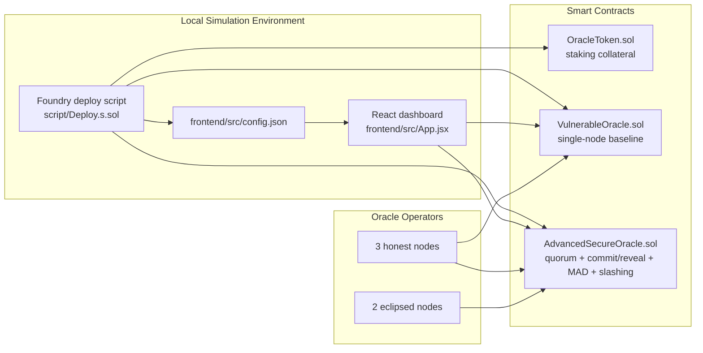

# Cryptoeconomic Defense Against Eclipse Attacks

**Author: Jayendra Singh**

**A full-stack blockchain security simulation showing how application-layer cryptoeconomics can neutralize oracle eclipse attacks.**


## Overview

This repository demonstrates a practical answer to a hard blockchain security question:

> Can a network-layer eclipse attack be made economically irrational at the application layer?

This project shows that the answer can be yes.

The repo contains:

- a vulnerable single-node oracle baseline
- a hardened oracle committee with stake-backed accountability
- a React dashboard that lets you simulate attacks and defenses in real time
- a Foundry-based contract and test environment for reproducible local experiments

The core defense combines:

- `3-of-5` quorum finalization
- commit-reveal submissions
- median-based aggregation
- Mean Absolute Deviation (MAD) anomaly detection
- delayed slashing and honest-node reward redistribution

For deeper structure and maintenance notes, see [ARCHITECTURE.md](./ARCHITECTURE.md) and [IMPROVEMENTS.md](./IMPROVEMENTS.md).

## Architecture Diagram



## What This Repo Demonstrates

### Vulnerable oracle path

A single authorized node reports price data directly. If that node is eclipsed, the attacker can feed it a false market view and the contract accepts the manipulated price without resistance.

### Hardened oracle path

The advanced oracle introduces economic and statistical defenses:

1. Nodes stake 1,000 OST before participating.
2. Nodes commit hashed prices first, then reveal them later.
3. A `3-of-5` quorum is required for safe progress.
4. The contract finalizes using the median rather than trusting one node.
5. MAD-based anomaly detection flags extreme outliers.
6. Suspicious or silent nodes enter a challenge state.
7. After the challenge window, half the stake is burned and half is redistributed to honest active nodes.

## Tech Stack

- Smart contracts: Solidity `^0.8.24`
- Local chain and tests: Foundry (`anvil`, `forge`)
- Frontend: React, Vite, `ethers.js v6`
- Deployment automation: Foundry script + Bash
- CI: GitHub Actions for contracts and frontend

## Improvements In This Version

- Standardized the protocol around a consistent `3/5` quorum across contract, deploy script, config, tests, and UI.
- Added contract-side round state helpers and a phase transition event for better observability.
- Cleaned up the dashboard to use clearer state refresh patterns and a live activity feed.
- Added dedicated architecture and improvement docs for maintainability.
- Removed unrelated scaffold files from the Foundry starter template.
- Improved repo hygiene with a stronger `.gitignore` and broader CI coverage.

## Getting Started

### Prerequisites

- [Node.js](https://nodejs.org/en/) `18+`
- `npm`
- [Foundry](https://book.getfoundry.sh/getting-started/installation) with `forge` and `anvil`

### Clone

```bash
git clone https://github.com/Jayendra70/Blockchain_project.git
cd Blockchain_project
```

### Install frontend dependencies

```bash
cd frontend
npm install
cd ..
```

## Local Development Commands

From the project root:

```bash
npm run deploy:local
npm run frontend:dev
npm run frontend:build
npm run frontend:lint
forge test -vvv
```

## Running The Full Demo

You will need two terminals.

### Terminal 1: start the local chain

```bash
anvil
```

### Terminal 2: deploy contracts and start the dashboard

```bash
npm run deploy:local
npm run frontend:dev
```

Then open `http://localhost:5173`.

## Foundry Test Coverage

The Solidity test suite exercises the main security properties:

- `test_VulnerableOracle_Attack`
  The baseline oracle accepts manipulated data from the single authorized node.
- `test_AdvancedOracle_Eclipse_Simulation`
  The advanced oracle keeps the correct median and challenges the outlier.
- `test_AdvancedOracle_ForceCommitTimeout`
  Silent committers are challenged and liveness handling is preserved.
- `test_AdvancedOracle_ForceRevealTimeout_WithQuorum`
  Honest reveals can still finalize the round when quorum is met.
- `test_AdvancedOracle_ConstructorRejectsInvalidQuorum`
  Invalid quorum settings are rejected at deployment.
- `test_AdvancedOracle_ReportsRoundState`
  Frontend-friendly round state helpers report the expected protocol state.

## Interactive Dashboard Scenarios

The dashboard lets you trigger both failure and defense flows visually.

### Vulnerable oracle

1. Open the `Vulnerable Oracle` view.
2. Trigger the eclipse attack.
3. Observe that the reported price can be forced to `$1` with no staking, no quorum, and no slashing.

### Advanced oracle

Try these scenarios in the `Advanced Oracle` view:

1. Standard eclipse attack
   Honest nodes submit the correct price, eclipsed nodes submit a malicious price, and the median remains safe.
2. Slashing execution
   Fast-forward one day and execute slashing to see burn and redistribution mechanics.
3. Withholding commits
   Let only part of the network commit, then force commit timeout.
4. Withholding reveals
   Let quorum reveal while malicious nodes stay silent, then force reveal timeout.
5. Quorum failure
   Reveal below quorum and observe the round reset behavior.

## Repository Structure

```text
├── contracts/
│   ├── AdvancedSecureOracle.sol
│   ├── OracleToken.sol
│   ├── SecureOracle.sol
│   └── VulnerableOracle.sol
├── frontend/
│   ├── src/
│   │   ├── App.jsx
│   │   ├── config.json
│   │   └── index.css
│   └── package.json
├── script/
│   └── Deploy.s.sol
├── scripts/
│   └── deploy_frontend.sh
├── test/
│   └── Simulation.t.sol
├── ARCHITECTURE.md
├── IMPROVEMENTS.md
├── Project_Report.md
├── VideoScript.md
└── README.md
```

## Validation Notes

- The Solidity contracts compile successfully with `solc`.
- The frontend source passes a JSX transpile sanity check.
- Full local `forge test`, `vite build`, and `eslint` execution depend on having the corresponding tools installed in the target environment.


## 🎥 Video Presentation & Proof of Concept
**[🔗 Watch the Full Video Presentation Here]
https://drive.google.com/file/d/1yyiw6C3MnVbg3HWWm-7omivlklMCxkIt/view?usp=share_link